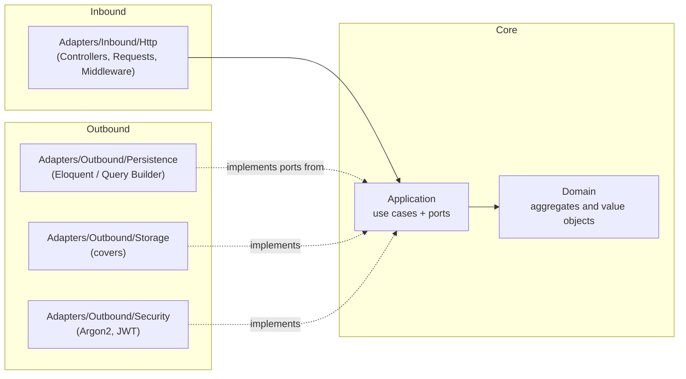
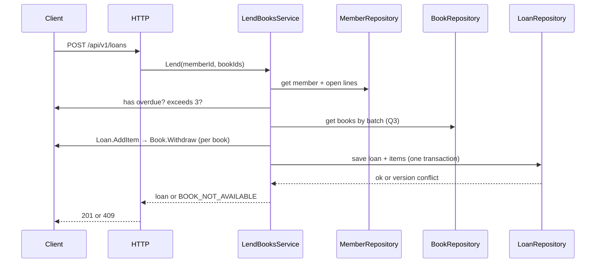

# Architecture — Manager Library (Laravel)

Hexagonal architecture (ports and adapters) inside a Laravel application. Dependency rules are Articles I-III
of [`constitution.md`](../spec-python/constitution.md).

## 1. Layers and dependencies



Dependency arrows point **inward**. `Bootstrap` is the only layer that sees both halves.

## 2. Folder structure

```text
api/
├── app/
│   ├── Domain/                         # Pure PHP: no Illuminate, no Eloquent (Art. I)
│   │   ├── Book.php  Loan.php  LoanItem.php  Member.php  User.php
│   │   ├── ValueObjects/  Isbn.php  Quantity.php  DocumentNumber.php  DateRange.php
│   │   ├── LoanStatus.php              # enum open|overdue|closed (calculated)
│   │   └── Exceptions/  BookNotAvailable.php  MemberHasOverdue.php  MemberLimitExceeded.php
│   │                    DuplicateBookInLoan.php  ItemAlreadyReturned.php  BookHasOpenLoans.php
│   ├── Application/                    # Only knows Domain (Art. II)
│   │   ├── Ports/  BookRepository  LoanRepository  MemberRepository  UserRepository
│   │   │           ReportReader  Clock  PasswordHasher  TokenIssuer  CoverStorage
│   │   └── Services/  LoginService  CreateLibrarianService  CreateBookService  UpdateBookService
│   │                  DeleteBookService  SearchBooksService  UploadCoverService  CreateMemberService
│   │                  LendBooksService  ReturnItemService  OverdueService  MostBorrowedReportService
│   ├── Adapters/
│   │   ├── Inbound/Http/  Controllers/  Requests/  Middleware/ (JwtAuth, RequireRole)
│   │   │                  ErrorMapper.php (domain exception → {code,message,details} + status)
│   │   └── Outbound/  Persistence/ (Eloquent or Query Builder)  Storage/  Security/ (Argon2, Jwt)
│   │                  SystemClock.php
│   └── Bootstrap/PortBindingsServiceProvider.php   # SOLE composition point (Art. III)
├── database/migrations/
│   ├── 0001_create_library_schema.php              # CREATE SCHEMA library
│   └── 0002_initial_schema.php                     # 6 tables, FK, CHECK, indexes, seed 5 categories
├── routes/api.php                                  # v1 prefix, contract routes
└── tests/
    ├── Unit/Domain/            # T-03…T-06
    ├── Application/            # T-07…T-11 with fakes (tests/Fakes/)
    ├── Integration/            # T-12, T-13 against Postgres
    ├── Contract/               # T-16: all routes and codes from §2
    ├── Concurrency/            # RNF-2: last copy
    └── Architecture/           # T-19: Pest Arch
```

## 3. Aggregates

| Root | Contains | Invariants |
|---|---|---|
| `Book` | `Isbn`, total and available copies, logical delete | available between 0 and total; total ≥ 1; title not empty |
| `Loan` | collection of `LoanItem` | 1 to 3 items; no duplicate book; due date at 14 days; immutable except return |
| `Member` | document number | document required and unique |
| `User` | role, hash | normalized name; role in (`admin`, `librarian`) |

`Loan.AddItem` calls `Book.Withdraw` before adding the line: decrementing the copy and creating the line are
**one single operation**. `Loan.ReturnItem` calls `Book.Restock` exactly once per line.

## 4. Flow: register a loan



## 5. Errors

Domain and application throw their own exceptions (`BookNotAvailable`, `MemberHasOverdue`, `MemberLimitExceeded`,
…). **Only** the HTTP adapter translates them to the unique error body and status code from
[`api-contract.md`](../spec-python/api-contract.md). A framework error never reaches the client.

## 6. What is not there

No events, no queues, no cache, no microservices, no multi-tenancy. Added only if a requirement asks for it.
